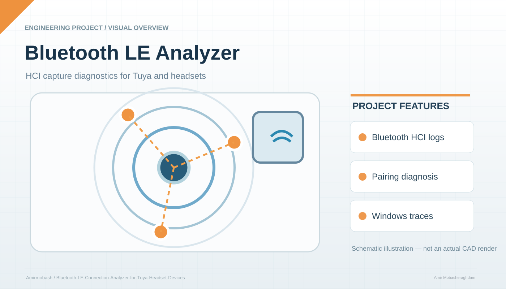

# Bluetooth LE Connection Analyzer for Tuya & Headset Devices


<p align="center"></p>

<sub>Illustrative project schematic; not an actual CAD export, hardware photograph, or independently tested result.</sub>


[](https://www.python.org/)
[](https://opensource.org/licenses/MIT)

A powerful tool to analyze Wireshark Bluetooth HCI logs and diagnose why your Tuya devices or Bluetooth headsets fail to connect, get stuck, or disconnect immediately on Windows.

## 📖 Table of Contents

- [Overview](#overview)
- [Problem Statement](#problem-statement)
- [Features](#features)
- [How It Works](#how-it-works)
- [Installation](#installation)
- [Usage](#usage)
- [Sample Output](#sample-output)
- [Common Issues & Solutions](#common-issues--solutions)
- [Contributing](#contributing)
- [License](#license)

## Overview

When Bluetooth devices (especially Tuya IoT modules or wireless headsets) repeatedly fail to connect or disconnect immediately after pairing, the root cause is often hidden deep inside Wireshark packet logs. This repository provides two Python scripts that automatically parse and analyze your `.txt` log files to identify the exact point of failure.

## Problem Statement

You experience one of these symptoms on Windows:

- Your Bluetooth headset connects, then **immediately disconnects** ("sarii baste mishavad").
- Your Tuya device keeps **canceling connection attempts** (`LE Create Connection Cancel`).
- The device pairs successfully but **no data is exchanged** (no GATT services found).
- The connection drops after exactly a few seconds without any manual action.

This tool helps you find out **why**.

## Features

✅ **Automated Detection** – Scans logs for `LE Create Connection`, `Cancel`, `Disconnect`, and `LE Enhanced Connection Complete` events.  
✅ **Connection Duration** – Calculates how long each connection lasted before disconnection.  
✅ **GATT Discovery Check** – Detects if any attribute protocol (service discovery) took place.  
✅ **Vendor Identification** – Finds "Tuya" or other device names in the log.  
✅ **Actionable Advice** – Prints specific Windows troubleshooting steps based on the failure pattern.

## How It Works

The script uses regular expressions to parse a Wireshark **plain text export** of a Bluetooth HCI capture. It looks for:

| Event                         | Meaning                                                    |
|-------------------------------|------------------------------------------------------------|
| `LE Create Connection`        | Host requests a new connection.                            |
| `LE Create Connection Cancel` | Host cancels the request before completion.                |
| `LE Enhanced Connection Complete` | Physical link successfully established.              |
| `Read By Group Type Request`  | GATT discovery started (real data exchange).               |
| `Disconnect` / `Disconnect Complete` | Connection was intentionally closed.           |

The script then prints a timeline and a final diagnosis.

## Installation

1. **Clone the repository**
   ```bash
   git clone https://github.com/yourusername/bluetooth-connection-analyzer.git
   cd bluetooth-connection-analyzer